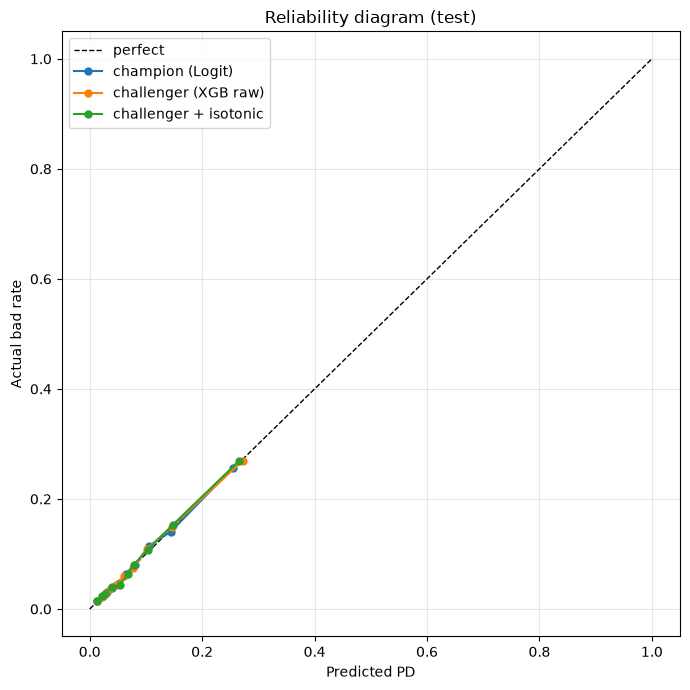
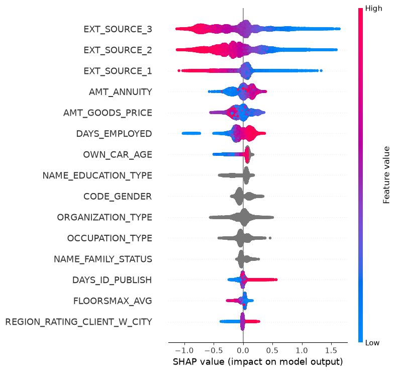
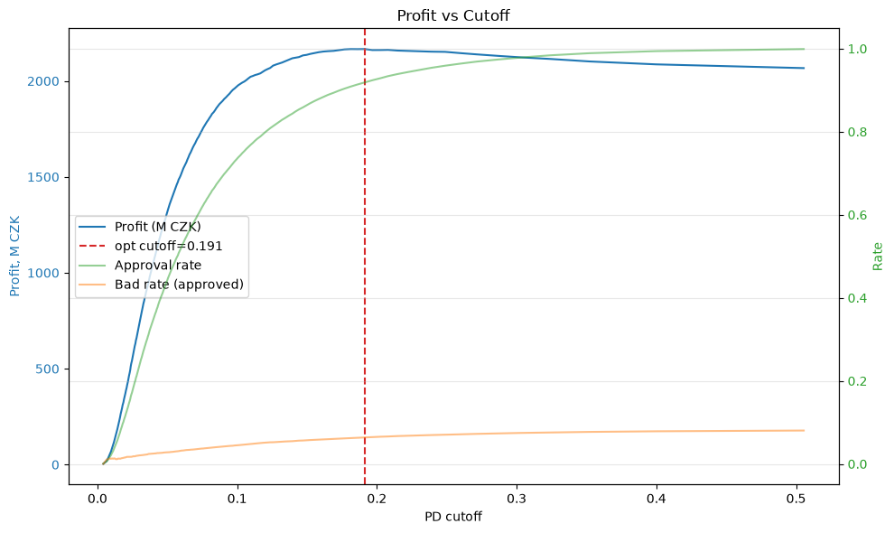
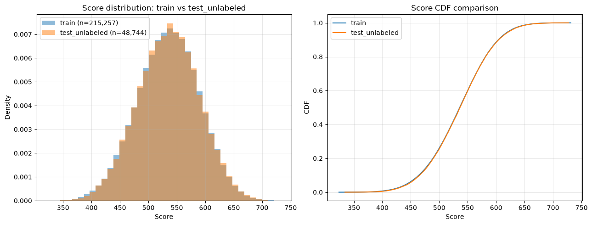

# Credit Scoring PD Model

Probability-of-Default модель на данных Home Credit с интерпретируемой логистической регрессией (champion) и XGBoost (challenger). Полный пайплайн: EDA → подготовка → WoE-биннинг → отбор фич → обучение → калибровка → cutoff-анализ → PSI-мониторинг.

## Результаты

| Модель              | Gini (valid) | Gini (test) | KS (test) | AUC (test) | Brier |
|---------------------|--------------|-------------|-----------|------------|-------|
| **Champion** (Logit + WoE) | 0.484 | **0.489** | 0.368 | 0.744 | 0.069 |
| **Challenger** (XGBoost, raw) | 0.498 | **0.512** | 0.388 | 0.756 | 0.068 |

**Δ Gini (test) = +0.023.** Bootstrap-CI на valid пересекаются — статистически значимой разницы нет (см. [этап 8](docs/final_metrics.json)). Оставляем **интерпретируемый Logit как champion**.



---

## Бизнес-контекст

Банк-платформа хочет автоматизировать принятие решений по кредитным заявкам и оценивать ожидаемые потери. Нужна модель, которая:
- предсказывает вероятность дефолта (PD);
- **объясняет** решение (требование регулятора);
- монотонна по риску (стандарт банковского скоринга);
- встроена в бизнес через cutoff и Expected Loss.

## Датасет

**Home Credit Default Risk** (Kaggle):
- `application_train.csv` — 307 511 × 122
- `application_test.csv` — 48 744 × 121 (unlabeled, holdout)
- Target: `TARGET = 1` = дефолт (90+ дней просрочки или charge-off)
- Prevalence: **8.07%**, дисбаланс ≈ 11:1

## Пайплайн

```text
01_eda.ipynb    →  data cleaning plan + config.yaml
prepare.py      →  4 parquet (train/valid/test/test_unlabeled)
woe.py          →  32 фичи забиннены, IV-таблица
selection.py    →  19 фич (IV + корреляция + VIF)
champion.py     →  Logit + scorecard
challenger.py   →  XGBoost + SHAP
calibration.py  →  reliability diagram + gains
cutoff.py       →  profit curve + Expected Loss
psi.py          →  мониторинг train vs test_unlabeled
```

### EDA (этап 1)

- **16 категориальных**, **72 числовых**, **32 флагов**.
- Сенсоры: `DAYS_EMPLOYED=365243` (18% данных).
- Пропуски: 41 колонка с 50–90% NaN, все housing features — drop по низкому IV.
- Решения зафиксированы в `configs/config.yaml`.

### WoE-биннинг (этап 4)

- `OptimalBinning` из `optbinning` с монотонными трендами.
- **Fit только на train**, transform на valid/test/test_unlabeled.
- Топ фич по IV:

| Фича                | IV    | bins | trend      |
|---------------------|-------|------|------------|
| EXT_SOURCE_3        | 0.333 | 12   | descending |
| EXT_SOURCE_2        | 0.322 | 12   | descending |
| EXT_SOURCE_1        | 0.150 | 8    | descending |
| DAYS_EMPLOYED       | 0.116 | 11   | ascending  |
| AMT_GOODS_PRICE     | 0.093 | 11   | auto       |

### Отбор фич (этап 5)

Три фильтра:
1. **IV ≥ 0.02** — отсеяли 2 фичи.
2. **Корреляция |r| > 0.7** — оставили сильнейшую по IV из каждой пары. Отсеяли 9 (housing-кластер `FLOORSMAX_*`, `LIVINGAREA_*`, `TOTALAREA_*`).
3. **VIF < 5** — 0 удалено (корреляционный фильтр уже почистил).
4. **final_review** — `EMERGENCYSTATE_MODE` и `DAYS_BIRTH` убраны вручную (sign flip + нулевой вклад в Gini).

**Финальный набор: 19 фич, IV sum = 1.72.**

### Champion — Logit + scorecard (этап 6)

- Все коэффициенты значимы (кроме 1 с p=0.06), все с правильным знаком.
- Скоркарта points-to-double-odds: **PDO=40, range 324–740**.
- Bad rate по децилям балла монотонно убывает: **25.4% → 1.5%**.

**Пример скоркарты** (top-5 по IV, points per WoE unit):

| Фича                | β coefficient | points/WoE unit |
|---------------------|---------------|-----------------|
| EXT_SOURCE_3        | -1.24         | +71.6           |
| EXT_SOURCE_2        | -1.08         | +62.3           |
| EXT_SOURCE_1        | -0.52         | +30.0           |
| DAYS_EMPLOYED       | -0.41         | +23.7           |
| AMT_GOODS_PRICE     | -0.38         | +21.9           |

Полная скоркарта — в [`artifacts/scorecard.csv`](artifacts/scorecard.csv).

### Challenger — XGBoost + SHAP (этап 7)

- **20 сырых фич** (19 + флаг сенсора `DAYS_EMPLOYED_IS_SENSOR`).
- Early stopping на 200 итерациях.
- Топ SHAP:

| Фича                | SHAP share |
|---------------------|------------|
| EXT_SOURCE_3        | 20.2%      |
| EXT_SOURCE_2        | 17.5%      |
| EXT_SOURCE_1        | 8.3%       |
| AMT_ANNUITY         | 6.1%       |
| AMT_GOODS_PRICE     | 6.0%       |
| DAYS_EMPLOYED       | 5.9%       |

**SHAP top-10 ∩ IV top-10 = 6 фич** — модели смотрят частично на разные сигналы, но пересечение приемлемое. Ни одной фичи с share > 50% — leakage нет.



### Калибровка (этап 8)

| Модель | HL χ² | p-value | Вердикт |
|---|---|---|---|
| Champion | 9.49 | 0.303 | calibrated |
| Challenger (raw) | 5.66 | 0.685 | calibrated |
| Challenger + isotonic | 14.11 | 0.079 | worsened |

**XGBoost с `objective="binary:logistic"` уже калиброван** — он минимизирует log-loss, что даёт честные PD. Isotonic regression проверен и **отклонён**: он ухудшил HL и слегка ухудшил Gini (0.5118 → 0.5095). В проде используем сырой XGBoost.

### Cutoff + Expected Loss (этап 9)

Параметры бизнеса: EAD=500k CZK, LGD=0.60, rate_total=0.15 (cost_ratio = 4).

**Оптимальный cutoff = 0.191**, что совпадает с теоретическим `(rate·EAD) / (rate·EAD + LGD·EAD) = 0.20`. Модель находит математически корректную точку максимума прибыли.

| Метрика | Значение |
|---|---|
| Approval rate | 91.9% |
| Bad rate (approved) | 6.4% |
| Profit (total) | 2166M CZK |
| **Expected Loss** | **810M CZK (3.8%)** |

**Sensitivity analysis:**

| cost_ratio | optimal_cutoff | approval | bad_rate |
|---|---|---|---|
| 2 | 0.352 | 98.9% | 7.7% |
| 4 (base) | 0.181 | 90.8% | 6.2% |
| 6 | 0.147 | 85.8% | 5.6% |
| 10 | 0.127 | 81.8% | 5.3% |

Чем дороже FN (отклонить хорошего) — тем ниже cutoff. Логика подтверждена.



### Мониторинг PSI (этап 10)

Train vs test_unlabeled:

| Метрика | Значение | Вердикт |
|---|---|---|
| Max feature PSI | 0.083 (`AMT_GOODS_PRICE`) | no drift |
| Median feature PSI | 0.002 | no drift |
| Score PSI | 0.0003 | no drift |
| Watchlist (0.10–0.25) | — | — |
| Alerts (>0.25) | — | — |

**Baseline PSI из EDA подтверждён** на WoE-значениях: max = 0.083 совпал.



---

## Воспроизведение
```bash

# 1. Установка
python3 -m venv .venv
source .venv/bin/activate
pip install -r requirements.txt

# 2. Данные (скачать с Kaggle)
# application_train.csv, application_test.csv → data/raw/

# 3. Полный пайплайн
make data        # prepare.py — 4 parquet
make woe         # WoE-биннинг
make select      # отбор фич
make champion    # Logit + scorecard
make challenger  # XGBoost + SHAP
make calibrate   # калибровка + gains
make cutoff      # profit curve + EL
make psi         # мониторинг
make test        # все юнит-тесты
```

---

## Структура проекта

```text
credit-scoring-pd-model/
├── src/
│   ├── data/prepare.py            # этап 2+3 — подготовка
│   ├── features/
│   │   ├── woe.py                 # этап 4 — WoE-биннинг
│   │   └── selection.py           # этап 5 — отбор фич
│   ├── models/
│   │   ├── champion.py            # этап 6 — Logit + scorecard
│   │   └── challenger.py          # этап 7 — XGBoost + SHAP
│   ├── evaluation/
│   │   ├── calibration.py         # этап 8 — калибровка + gains
│   │   └── cutoff.py              # этап 9 — profit curve + EL
│   ├── monitoring/psi.py          # этап 10 — мониторинг
│   └── utils.py                   # EDA-хелперы
├── notebooks/01_eda.ipynb         # этап 1 — EDA
├── tests/                         # pytest smoke-tests
├── configs/config.yaml            # единый источник правды
├── data/
│   ├── raw/                       # application_{train,test}.csv
│   └── processed/                 # 8 parquet
├── artifacts/                     # binners, модели, отчёты
├── docs/                          # скриншоты и JSON для README
├── requirements.txt
├── Makefile
└── README.md
```

## Стек

| Категория | Инструмент |
|---|---|
| Data | pandas 2.x, numpy, pyarrow |
| WoE-биннинг | `optbinning` |
| Модели | `statsmodels` (Logit), `xgboost` 3.x |
| Интерпретация | `shap` |
| Метрики | `scikit-learn`, `statsmodels` |
| Визуализация | `matplotlib`, `seaborn` |
| Тесты | `pytest` |

## Ограничения и что дальше

- **Expected Loss 3.8%** выше банковского target (<2%). Решения: снизить LGD до 0.40, повысить cutoff, или увеличить ставку.
- **Out-of-time валидация** не проведена — в Home Credit нет даты заявки.
- **Reject inference** не сделан — модель обучена только на одобренных заявках.
- **Композитные фичи** (`CREDIT_INCOME_RATIO`, `ANNUITY_INCOME_RATIO`, `EXT_SOURCE_MEAN`) не добавлены — потенциально +2–3 pp Gini.
- **Мониторинг** — только baseline PSI. В проде нужен регулярный пересчёт и алерты по порогам 0.10 / 0.25.
- **Isotonic calibration** проверен и отклонён — XGBoost с `binary:logistic` уже калиброван.

## Лицензия

MIT
